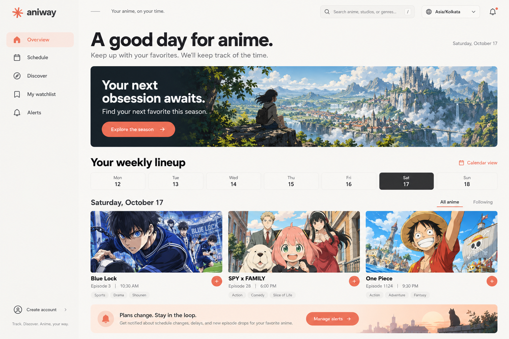

# aniway

**Your anime, on your time.** aniway brings upcoming episodes, seasonal discovery, personal watchlists, progress tracking, schedule alerts, and Crunchyroll library sync into one calm tracker.

[](https://github.com/HarshitKumar9030/aniway/stargazers)
[](https://github.com/HarshitKumar9030/aniway/issues)
[](https://github.com/HarshitKumar9030/aniway)
[](https://github.com/HarshitKumar9030/aniway/commits/main)



*Dashboard design concept. The shipped interface is implemented in the app; anime schedule times and streaming availability come from external services and can vary by region.*

## What it does

- **Follow the schedule:** browse upcoming episodes in your timezone, with daylight-saving and date-rollover handling.
- **Find something new:** explore seasonal anime and save shows to your watchlist.
- **Keep your progress:** track episodes watched and carry completed Crunchyroll history into matching shows.
- **Catch changes:** see personal release, hiatus, and schedule-change notices while the app is open; export a calendar snapshot.
- **Connect Crunchyroll:** securely sync your watchlist and watch history. The optional browser extension copies the `etp_rt` cookie and its expiry for a manual, encrypted connection.

AniList supplies Japanese broadcast times, which may differ from subtitled streaming availability. Crunchyroll access depends on your region and subscription. Aniway does not modify your Crunchyroll library.

## Run locally

Requirements: Node.js 22.13 or later.

```bash
npm ci
npm run db:migrate:local
npm run dev
```

Open the local address printed by Vite (usually <http://127.0.0.1:5173>). The local D1 database is stored in `.wrangler/state` and is not committed. For a fresh database, create a local encryption key:

```bash
node --input-type=module -e 'import {writeFileSync} from "node:fs"; import {randomBytes} from "node:crypto"; writeFileSync(".dev.vars", "CRUNCHYROLL_ENCRYPTION_KEY=" + randomBytes(32).toString("hex") + "\n", {mode: 0o600, flag: "wx"})'
```

This command refuses to overwrite an existing `.dev.vars`. Keep the same key wherever you need to read previously stored Crunchyroll connections. Never commit `.dev.vars`, `.env*`, database credentials, or encryption keys.

`npm run build` creates the Cloudflare Worker build. Local D1 migrations use `wrangler.local.json`; `npm run db:generate` creates migration files but does not apply them.

## Deploy to Vercel

The repository includes a Vercel build configuration. Link the GitHub repository to a Vercel project with the repository root as its root directory. Vercel builds with `npm ci` and `npm run build:vercel`.

Vercel does not provide Cloudflare D1, so the Vercel runtime uses Turso/libSQL. Add the Turso integration to the Vercel project to provide `TURSO_DATABASE_URL` and `TURSO_AUTH_TOKEN`. Set `CRUNCHYROLL_ENCRYPTION_KEY` as a Vercel environment variable; generate a fresh value with `openssl rand -hex 32` and keep it stable across deployments. Pull the database variables into a trusted local shell and initialize the database once with:

```bash
npm run db:push:turso
```

See [`vercel.json`](vercel.json) and [`drizzle.turso.config.ts`](drizzle.turso.config.ts). Keep credentials and encryption keys out of Git and issue reports.

## Contributing

Bug reports and focused pull requests are welcome. Before starting a large change, open an issue to discuss the behavior and scope.

1. Fork the repository and create a branch from `main`.
2. Install dependencies with `npm ci` and initialize the local database as described above.
3. Make a focused change. Keep user data private, avoid logging credentials, and preserve the rule that aniway progress never regresses during sync.
4. Run the checks that apply to your change:

   ```bash
   node --test tests/*.test.mjs
   node node_modules/typescript/bin/tsc --noEmit
   npm run build
   ```

5. Open a pull request against `main`. Include the motivation, a short behavior summary, test results, and screenshots for visible UI changes. Never attach real session cookies, tokens, or account data.

For bugs, include steps to reproduce, expected and actual behavior, browser/OS, and relevant redacted logs. Feature requests should explain the user problem and proposed behavior.

## Security and account data

Passwords use scrypt with independent random salts and constant-time comparisons. Session tokens are random and only their digests are stored in D1. Cookies are HttpOnly, SameSite=Lax, and Secure over HTTPS; sessions expire after 30 days and are revoked on logout. Authentication is rate-limited, and mutation endpoints validate request origin. Passwords must be at least 15 characters. Email verification and password recovery delivery are not configured.

Crunchyroll session data is encrypted with AES-256-GCM before persistence. Only the `etp_rt` cookie is accepted from a copied cookie header; unrelated cookies are discarded. API requests stay on Crunchyroll's default host, reject redirects, and do not log credentials. Disconnect removes the stored session and cache. Cookie expiry reminders describe browser-cookie expiry only; they cannot predict early revocation by Crunchyroll.

If you discover a security issue, do not open a public issue containing exploit details or user data. Contact the repository owner privately.

## More details

- [`extensions/crunchyroll-cookie`](extensions/crunchyroll-cookie/README.md) — install and use the Chrome/Edge cookie helper.
- [`public/anime-landscape.png`](public/anime-landscape.png) — the landscape artwork used by the interface.
- [`tests/`](tests/) — cookie handling, API transport, worker behavior, and seasonal watchlist tests.

Anime artwork and catalogue data may be subject to their respective provider terms. The Crunchyroll logo asset is sourced from [Wikimedia Commons](https://commons.wikimedia.org/wiki/File:Crunchyroll_2024.svg).
